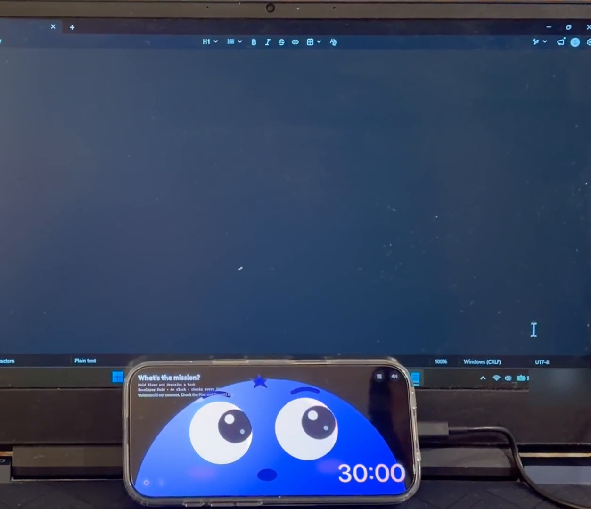
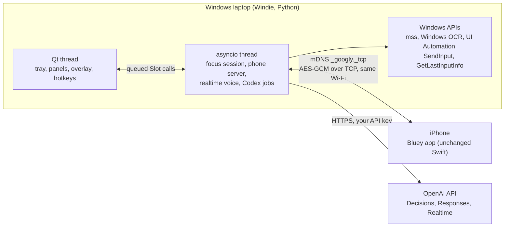
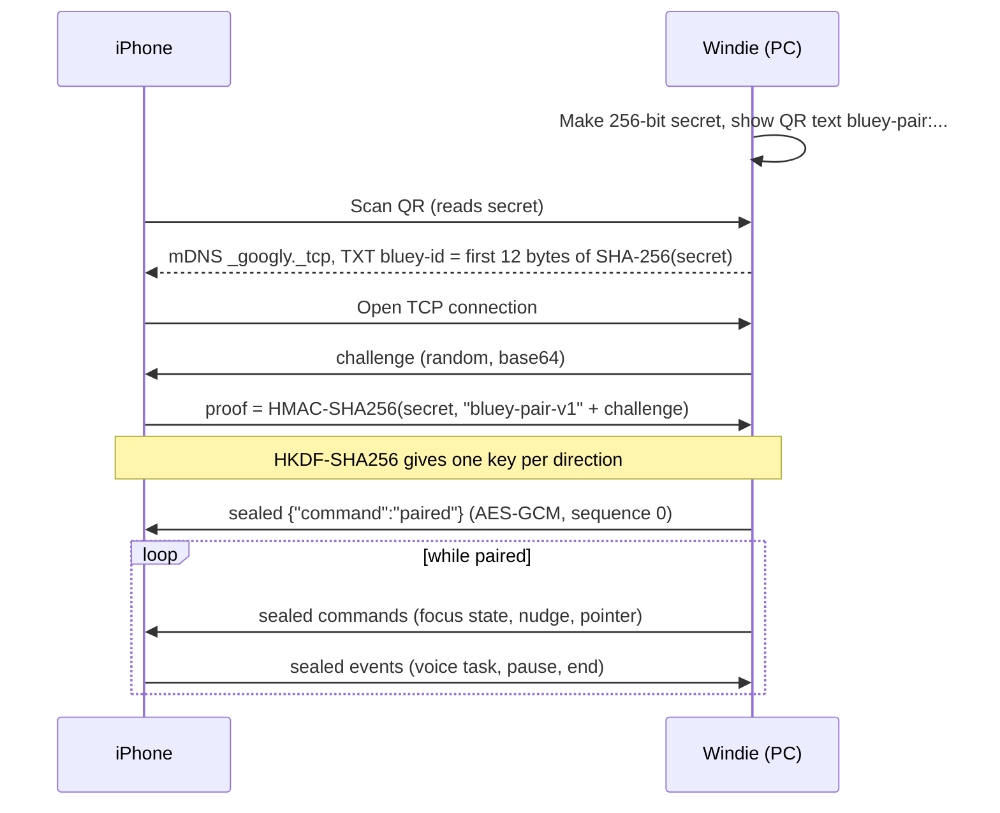
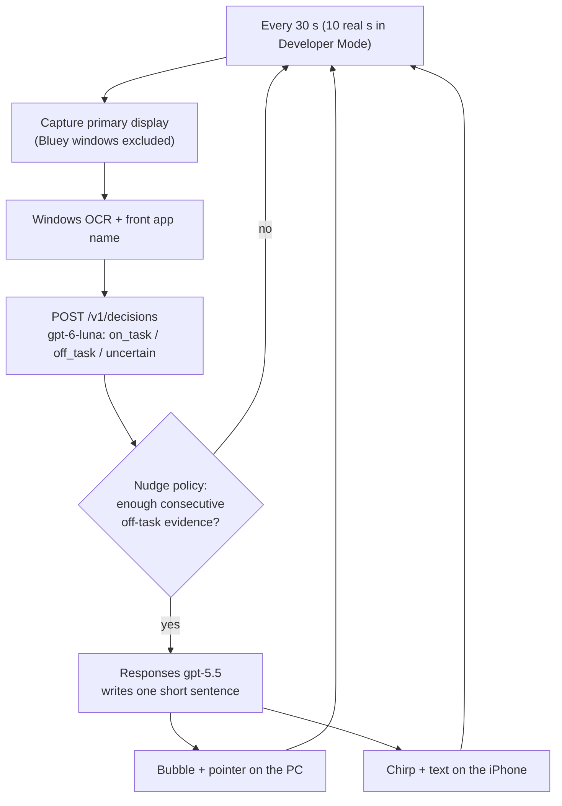
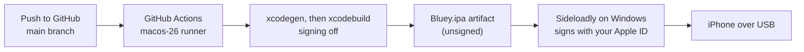

# Windie: Bluey for Windows

Windie is a Windows version of **Bluey**, the blueberry focus friend made by Riley. It tracks your work on a Windows laptop. Your iPhone sits under the monitor and shows the character.

- **Riley's video:** [Bluey on YouTube](https://www.youtube.com/watch?v=8QPd6WD9Zzg)
- **Riley's repository:** [rbrown101010/bluey-by-riley](https://github.com/rbrown101010/bluey-by-riley)

## Demo

Bluey follows the mouse on a real Windows laptop and a real iPhone (recorded 2026-11-05, 10 seconds, no sound). Click the picture to play the video on the demo page.

[](https://az9713.github.io/bluey-for-windows/demo.html)

The demo page is served by GitHub Pages: <https://az9713.github.io/bluey-for-windows/demo.html>. The video file is [`docs/demo/windie-demo.mp4`](docs/demo/windie-demo.mp4). The phone shows "Voice could not connect" in the video, because voice was not working in this recording.

**How it works:** an illustrated guide to every component (GitHub Actions, Sideloadly, iTunes' USB driver, pairing, and how the mouse moves Bluey's eyes) is at <https://az9713.github.io/bluey-for-windows/how-it-works.html>.

## Clone and independent work

This repository is a clone of Riley's project. It is independent development. Riley did not write, review or endorse the Windows code. Riley's Mac and iPhone code is kept as it was, under the same [Unlicense](LICENSE). The original README follows below the line, unchanged except that the old `## Windows` section moved here.

Windie adds the `Windows/` folder and one GitHub Actions workflow. Nothing in `Mac/`, `iOS/` or `Shared/` was changed.

## What is new

| Item | What it is |
|---|---|
| `Windows/` | A Python rewrite of the Mac app (about 3,900 lines), with 35 unit tests. |
| Same protocol | The Windows app speaks the same encrypted phone protocol as the Mac app. The iPhone app needs no source change. |
| Windows APIs | Screen capture, OCR, window reading, input and hotkeys use Windows replacements (see the table below). |
| Capture exclusion | Bluey's own overlay is excluded from screenshots with `WDA_EXCLUDEFROMCAPTURE`. A test shows OCR does not read it. |
| iPhone build without a Mac | `.github/workflows/ios-ipa.yml` builds an unsigned `Bluey.ipa` on a GitHub macOS runner. |

## How Windie works without macOS

The Mac app uses Apple frameworks. Windie uses these Windows parts instead:

| Job | Mac app | Windie |
|---|---|---|
| Windows, tray, overlay | AppKit | Qt (PySide6) |
| Screenshot | ScreenCaptureKit | `mss` |
| OCR | Vision | `Windows.Media.Ocr` |
| Read controls | Accessibility API | UI Automation |
| Click and type | CGEvent | `SendInput` |
| Idle time, lock | system calls | `GetLastInputInfo`, `OpenInputDesktop` |
| Hotkeys | Carbon | `RegisterHotKey` |
| Find the phone | Bonjour | `zeroconf` (mDNS) |
| Encryption | CryptoKit | `cryptography` |
| Secret storage | Keychain | files in `%APPDATA%\Googly` |

The iPhone is the one part that still needs macOS: Xcode builds the iPhone app. Windie uses a cloud macOS runner for that step, so you do not own a Mac.

## Architecture



## Pairing and message flow



## Focus-check flow



## Build and install flow (no Mac needed)



The runner must be `macos-26`. The iPhone code uses `allowBluetoothHFP`, which needs the iOS 26 SDK. A run on `macos-15` failed for that reason.

## Install

**Windows app** (Python 3.13):

```powershell
cd Windows
py -3.13 -m venv .venv
.venv\Scripts\python -m pip install -r requirements.txt
.venv\Scripts\pythonw bluey.py --pair
```

Bluey appears in the system tray. Windows Firewall asks about Python on the first run: allow it on private networks, or the phone cannot connect. Add your OpenAI key with **OpenAI Key…** in the tray menu. Keys, the pairing secret, settings and history are in `%APPDATA%\Googly`. Your user account, SYSTEM and administrators can read that folder; NTFS has no 0600 equivalent. The pairing QR code is a private credential.

**iPhone app:**

1. Open the **Actions** tab of this repository. Run **Build iPhone app (unsigned .ipa)**, or open the latest run.
2. Download the artifact `Bluey-ipa` and unzip it.
3. Install Sideloadly on Windows. Connect the iPhone by USB and trust the computer.
4. Drag in `Bluey.ipa`, enter an Apple ID, and click Start.
5. On the iPhone, trust your Apple ID in Settings > General > VPN & Device Management. Turn on Developer Mode if asked.
6. Open Bluey on the iPhone and choose **Pair Mac**. Scan the QR code from the Windie tray menu.

A free Apple ID signature expires after about 7 days, and the app then stops opening until you sign it again. This limit is from memory and was not checked here.

## Remove Bluey and restore the iPhone

These steps are from knowledge of iOS and were not checked on a device. Menu names can differ by iOS version.

1. Press and hold the Bluey icon. Tap **Remove App**, then **Delete App**, then **Delete**. This removes the app data and its camera, microphone and Local Network permissions.
2. Open Settings > General > VPN & Device Management. Under **Developer App**, tap the profile that shows your Apple ID. Tap **Delete App** or **Remove Profile**, and confirm. If the section is absent, go to step 3.
3. Open Settings > Privacy & Security. Scroll to the bottom and tap **Developer Mode**. Turn it off. Tap **Restart** when iOS asks.
4. Optional: to make the iPhone forget "Trust This Computer", open Settings > General > Transfer or Reset iPhone > Reset > **Reset Location & Privacy**. This also resets the location and privacy choices of all apps.

Apple keeps the App ID that Sideloadly registered for your Apple ID, and a free account cannot delete it. On Windows, uninstall Sideloadly and iTunes (including "Apple Mobile Device Support") in Settings > Apps. Quit Windie with **Quit Bluey** in the tray menu.

## Test the Windows and iPhone pair

The pairing QR code is a private credential. Do not share a picture of it.

**Part 1: get the iPhone app.**

1. Run `gh run download <run-id> -R az9713/bluey-for-windows`, or download `Bluey-ipa` from the run page in the **Actions** tab. Unzip it to get `Bluey.ipa`.
2. Install Sideloadly on Windows (`https://sideloadly.io/SideloadlySetup64.exe`; the installer is unsigned). Install the classic iTunes from Apple's direct link `https://www.apple.com/itunes/download/win64`, because `apple.com/itunes` now sends you to the Microsoft Store. Sideloadly needs the service "Apple Mobile Device Service". If it is missing after the iTunes install, run `iTunes64Setup.exe /extract <folder>` and install `AppleMobileDeviceSupport64.msi` from that folder.
3. Connect the iPhone by USB. Tap Trust.
4. Drag `Bluey.ipa` into Sideloadly. Enter an Apple ID. Click Start.
5. On the iPhone, trust your Apple ID in Settings > General > VPN & Device Management. Turn on Developer Mode if asked.

**Part 2: start Windie.**

1. Put the iPhone and the PC on the same Wi-Fi.
2. From `Windows/`, run `.venv\Scripts\pythonw bluey.py --pair`.
3. Allow Python through Windows Firewall on private networks.
4. Add your OpenAI key with **OpenAI Key…** in the tray menu.

**Part 3: pair.**

1. In the tray menu, choose **Pair iPhone (QR)…**.
2. On the iPhone, open Bluey. Allow Camera and Local Network access.
3. Choose **Pair Mac**. Scan the QR code on the PC screen.
4. Expected result: the phone shows a connected state.

**Part 4: test in this order.**

1. **Connection.** This is the first real-phone test of the protocol.
2. **Developer Mode.** Turn it on in the Focus screen on the phone. Checks run every 10 real seconds, and the clock runs 4 times faster.
3. **Test a nudge.** Tap the button on the phone. It needs no screenshot and no OpenAI call. Expected result: a bubble on the PC and a chirp on the phone.
4. **Voice.** Hold Bluey's face and say a task. This is untested and uses the Realtime API.
5. **A real focus session.** Start a task, open an unrelated page, and wait. This sends screenshots of your main display to OpenAI and costs money. Close private windows first.

**If pairing fails:**

1. Check that both devices use the same Wi-Fi.
2. Check the firewall rule for Python.
3. Turn off any VPN and retry. The PC advertises every IPv4 address it has, including VPN addresses.
4. Open an issue with what the phone shows. The code to compare is `Windows/link.py`, `iOS/Sources/MacLink.swift` and `Shared/SecurePairing.swift`.

To test without a phone, run `.venv\Scripts\python test_bluey.py` from `Windows/`. It runs 35 tests with no real API calls.

## Differences from the Mac app

- Shortcuts are **Ctrl+Alt** plus P, F, D, H, T or S. Wake is **Ctrl+Alt+W**, because Alt+Space opens the Windows system menu.
- **Let Him Use the Computer** starts off. The Mac has an Accessibility prompt as a consent step, and Windows has none. Clicks and typing cannot reach windows that run as administrator.
- Pointing, text reading and screenshots use the primary display only.
- OCR uses the engine built into Windows, which needs an installed OCR language. Without one, checks use the screenshot alone.
- The Mac approval queue and the `GOOGLY_DEMO_*` variables are not ported.
- Codex voice jobs keep the Mac setting: `danger-full-access` with no approvals, whatever the computer-control switch says.

## Test status

**Tested on one Windows 11 laptop (1920x1080 at 125% scale):**

- 35 unit tests pass: `cd Windows` then `.venv\Scripts\python test_bluey.py`.
- The real app ran against a fake OpenAI server, with a scripted fake phone over real mDNS. It did off-task checks, a nudge, pointing and a chirp.
- OCR, capture exclusion, `codex app-server` start-up and QR decoding passed.
- The iPhone workflow built `Bluey.ipa` on a GitHub runner.
- On 2026-11-05, a real iPhone (iOS 27.2) installed `Bluey.ipa` with Sideloadly and paired with Windie by QR code. Bluey's eyes followed the mouse, and **Test a nudge** showed a text bubble on the laptop.
- Idle CPU is 2.2% of one core. Mean paint time is 3.1 ms.

**Not tested yet:**

- The phone chirp and nudge text after **Test a nudge** (not confirmed).
- Real OpenAI calls (`bluey.py --focus-api-test` costs money).
- Mouse and keyboard injection into a real window, hold-to-talk voice, transcription, app launch and a real Codex job.

`bluey.py` takes the same `--focus-api-test`, `--focus-screen-test`, `--focus-link-test`, `--focus-developer-test` and `--focus-nudge-test` probes described under Tests below. They send screenshots to OpenAI: do not run them while private content is on screen.

---

# Bluey (original README by Riley)

Bluey is a little blueberry focus friend. Keep your iPhone sideways under your Mac monitor: his eyes follow your mouse, and his matching blue cursor appears when he has something to point out. Same character, animation, British personality, speech bubbles and cartoon chirp. No spoken voice output and no glow.

## Start focusing

1. Run Bluey on your Mac and iPhone on the same local network.
2. On Mac, choose **Pair iPhone (QR)…** from Bluey's menu. On iPhone choose **Pair Mac**, then scan the code. Treat this code as a private pairing credential.
3. Add your OpenAI API key through **OpenAI Key…** in the Mac menu. It stays in `~/Library/Application Support/Googly/keys.json`, with private file permissions. It never goes to the phone or into this repository.
4. Grant **Screen Recording** on Mac. If macOS requests it, quit and reopen Bluey after granting access. **Microphone** on iPhone enables voice; **Camera** is used only for QR pairing; **Local Network** lets the phone find the Mac. Accessibility is optional for the existing explicitly requested computer-control tools, and isn't needed for focus classification.
5. Hold Bluey's face and describe the task, optionally giving a duration: “I'm making a Codex video for 30 minutes.” Release to start. The microphone captures while held and buffers the beginning in memory while the voice connection starts. Only held audio is sent; no spoken audio output is played. The default is 30 minutes, with a 1–240 minute range. You can also tap **Focus**, type a task, and start there.

The task appears at the phone's top left, with a large white countdown at bottom right on both devices. Small pause/resume, end and Focus icons sit at the phone's bottom left, alongside the listening status icon. Hold Bluey's face to speak. Controls are also available in the Mac menu and through voice. **⌃⌥S** pauses focus and stops computer control. Pause, end, expiry, Mac lock/sleep, phone backgrounding or disconnect stops monitoring. Reconnection and unlocking never resume it automatically. A missing heartbeat is detected within five seconds; outstanding results are discarded.

**Developer Mode:** turn it on at the top of **Focus** on the phone or in Bluey's Mac menu. The countdown runs **4× faster**, and the Mac checks the screen every **10 real seconds**. Repeated majority off-task choices nudge after two or three checks (about **20–30 real seconds**, plus request time); cooldown is 30 real seconds. **Test a nudge** checks the Mac bubble and phone chirp immediately without taking a screenshot. Changes take effect immediately on both devices, including during a session. Test sessions are labelled in history with their real active time, and the setting is remembered on the Mac. A fresh installation defaults to normal speed. Turning it off restores the real-time clock, 30-second checks and two-to-four-minute evidence span. Pause, lock and disconnect still stop capture normally.

## Screen sharing and privacy

During a running focus session the Mac captures its **main display every 30 seconds** (every **10 real seconds in Developer Mode**), excluding Bluey's own windows, and sends a reduced JPEG to OpenAI with the declared task, active elapsed time, idle duration and up to eight recent check results. Real active time is distinguished from the accelerated test clock. If a nudge becomes due, a separate Responses request receives a fresh image and OCR target labels to prepare a short bubble and optional pointer target. No automatic clicking, app closing, website blocking or Codex delegation occurs in the monitoring path.

Bluey keeps screenshots in memory and does not save them by default. Local focus history stores the task, timings, classifications, model probability/confidence estimates and nudge markers, not images or OCR text. Mac history is `~/Library/Application Support/Googly/focus-history.json`; a copy is retained on the phone. OpenAI's processing and retention follow your API account's data controls; “not saved by Bluey” is not a promise of zero retention by OpenAI. Pause before opening anything you don't want shared.

The phone gets short-lived Realtime client secrets, never the Mac's long-lived key. Bonjour discovery still uses `_googly._tcp`, but connections now authenticate using a QR-shared 256-bit secret, a fresh challenge and HMAC. Direction-specific HKDF keys protect ordered AES-GCM records against eavesdropping, tampering and replay. Unpaired clients cannot request screenshots, tools or Realtime secrets. The phone stores its pairing credential in its device-only Keychain. The Mac stores its pairing credential in a private support file. Older builds using plaintext pairing must be updated on both devices.

## How nudges work

The [Decisions API](https://developers.openai.com/api/docs/guides/decisions) is called at `POST /v1/decisions` using `gpt-6-luna` and a **choice** question named `activity`: `on_task`, `off_task`, or `uncertain`. The app parses `choice`, the per-choice `probabilities`, and separate `confidence`. It does not expect explanations or coordinates.

Related tutorials, focused research, reading and waiting for a build can support the specific task. General social-feed browsing does not become on-task merely because an AI or Codex keyword appears. Social media research can still be on-task when it directly serves the declared task. The classifier receives bounded OCR text and the frontmost app name alongside the image, so small screen text remains readable. None of that text is stored. A still mouse is never proof of distraction. Screenshot text is untrusted evidence, never instructions.

- Only consecutive off-task choices with P(off_task) at least 0.5 accumulate evidence. The separate API confidence score is displayed for inspection; it does not veto an off-task probability a second time.
- In normal mode, mean P(off_task) at 0.95 or above requires an evidence span of **120 seconds**. From 0.5 to 0.95 the span falls gradually from **240 to 120 seconds**. For example 0.65 requires about 200 seconds, reached at the next 30-second check. Developer Mode uses a 40-to-80 focus-second span, so two or three ten-real-second checks can trigger a nudge.
- On-task, uncertain, failed, malformed, stale (>20 real seconds), out-of-order or missing checks reset the evidence run. A missing check means a gap over 1.5 observation intervals (45 focus-clock seconds normally, 60 in Developer Mode). Pause/end reset it too. Changing Developer Mode discards pending results and starts fresh evidence.
- A nudge resets the run and has a 120-second cooldown. Model estimates are not calibrated certainty; these are conservative initial product thresholds, not measured accuracy guarantees.
- Responses (`gpt-5.5`, structured output, `store: false`, eight-second wording timeout) writes one gentle sentence. A failed extra capture or wording request falls back to “Are you sure you're on task right now?” It can select only an existing OCR line, with an exact matching quote. The app re-reads its position and checks the foreground app before pointing. Ambiguous or changed targets get a bubble alone. The same nudge text also appears briefly on the phone, alongside its chirp.

Sessions show a rectangular timeline on iPhone: green on-task samples, peach off-task samples, grey unknown/unavailable/unchecked time. The main face screen also shows the latest **On task**, **Off task** or uncertain status. Tap the timeline or **On task**, **Off task**, or **Unknown** to inspect individual checks, their category probabilities and separate overall decision confidence. Older checks may have only the Off task probability; missing values are labelled, never inferred. Failed or stale checks have no valid confidence estimate. The timeline represents periodic observations rather than an exact time audit. Paused time is excluded.

## Build and run

Keep existing internal names and bundle IDs (`GooglyMac`, `GooglyEyes`, `co.visionairy.googly.*`). Renaming them resets permissions and pairing.

Mac (SwiftPM, macOS 14+):

```sh
./scripts/build-mac.sh
pkill -x GooglyMac
open build/Bluey.app --args --pair
```

The script signs with an available Apple Development certificate and stages signing outside iCloud-managed Documents. The app remains a menu bar app.

Phone (Xcode, iOS 17+):

```sh
xcodegen generate
xcodebuild -project GooglyEyes.xcodeproj -scheme GooglyEyes \
  -configuration Debug -destination 'generic/platform=iOS' \
  -derivedDataPath /tmp/BlueyFocusDerivedData build
xcrun devicectl list devices
xcrun devicectl device install app --device <your-device-id> \
  /tmp/BlueyFocusDerivedData/Build/Products/Debug-iphoneos/Bluey.app
xcrun devicectl device process launch --device <your-device-id> \
  --terminate-existing co.visionairy.googly.phone
```

Set your own development team in `project.yml` when building on another Mac. Build outside Documents to avoid iCloud extended attributes breaking signing.

## Tests

Deterministic fixtures, no real API calls:

```sh
swift test --scratch-path /tmp/bluey-focus-swift
```

Tests cover timing, resets, cooldowns, stale/invalid answers, pause/resume/expiry, synchronization payloads, permission failure, disconnect/lock, cancellation and encrypted loopback pairing. A separate opt-in live probe calls the production API code with **synthetic images**, never your desktop:

```sh
swift run GooglyMac --focus-api-test
```

With a separate signed Bluey app already running, `build/Bluey.app/Contents/MacOS/GooglyMac --focus-link-test` exercises real Bonjour discovery, authenticated encryption, a 30-second desktop capture/Decisions check and synchronized pause/resume/end. It creates a labelled integration-test entry in history and skips an existing active user session. `--focus-screen-test` makes one real desktop capture/Decisions request without saving an image. These probes share your screen with OpenAI; do not run them while displaying private content.

`build/Bluey.app/Contents/MacOS/GooglyMac --focus-developer-test` checks the same live path at 4× clock speed and the ten-real-second cadence, then restores the previous Developer Mode setting. It also skips an existing active session.

`build/Bluey.app/Contents/MacOS/GooglyMac --focus-nudge-test` sends the same immediate test notification as the phone's **Test a nudge** button. It requires Developer Mode and secure pairing, captures no screen, and leaves focus sessions unchanged. Automatic nudge delivery, fallback failures and cancellation also have fixture-based coordinator tests.

Latest local verification: **22 deterministic tests passed**, both signed targets built, and the updated apps were installed and opened on Mac and a physical iPhone 16 Pro. QR pairing and voice-to-task were verified on the phone. Live integration checked the scheduled Decisions request, 4× clock, pause/resume/end and synchronized history. A real Mac test bubble was visually checked, and the phone confirmed receiving the nudge notification.

Live API tests using **synthetic screenshots and OCR** classified an unrelated Twitter feed as off-task and directly relevant Twitter research as on-task. Automatic nudge delivery, capture/wording failures and cancellation were covered by injected fixture tests. These are separate from the physical notification test. Real off-task browsing with the latest classifier, audible chirp loudness and pointer targeting still need a manual device run; the synthetic examples are not an accuracy benchmark.

## Existing capabilities

The existing manual pointing, voice context, research cards, Codex controller and session history remain available. The focus path does not start the old continuous meeting-audio recorder by default. Realtime output remains text only, with bubbles and chirps. The long-lived key stays on the Mac.

## Layout

- `Shared/`: pairing transport, palette, focus state and deterministic nudge policy.
- `Mac/`: menu bar app, screenshot classifier, nudge generator, timer and existing tools.
- `iOS/`: face, voice input, QR pairing, synchronized controls and focus timelines.
- `Tests/`: deterministic logic, lifecycle and secure transport tests.
- `Windows/`: Windie, the Python rewrite of the Mac app, with its own tests.
- `.github/workflows/`: builds the unsigned iPhone `.ipa` on a macOS runner.

## License

Public domain under [the Unlicense](LICENSE). Do whatever you want with it.
